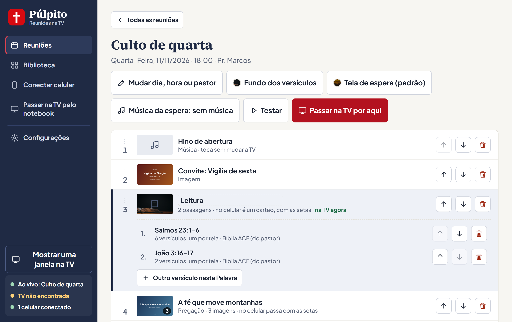

# Púlpito

**Programa para conduzir as reuniões da igreja pelo celular, projetando na TV.**

O pastor prepara a reunião no notebook (vídeos, imagens, músicas, pregação e versículos da Bíblia) e, na hora do culto, conduz tudo pelo celular: toca no cartão e o conteúdo aparece na TV. O celular não instala nada, só lê um QR code.

> Projeto voluntário, feito para a minha igreja e usado nas reuniões. Os usuários são pastores, alguns de idade e com pouca familiaridade com tecnologia. Por isso a simplicidade da interface foi o principal requisito.


## O problema

Antes, conduzir uma reunião exigia alguém no computador abrindo arquivos, trocando janelas e procurando versículos, e muitas vezes a tela do Windows aparecia na TV. Transmitir direto do celular (Chromecast, espelhamento) era instável e difícil para quem não tem costume com tecnologia.

## A solução

| Tela | Onde | Para que serve |
|------|------|----------------|
| **Painel** | Notebook | Preparar a reunião: escolher os itens, a ordem, os versículos e os arquivos da Biblioteca |
| **Telão** | TV (cabo HDMI) | Mostrar só o conteúdo, em tela cheia, nunca a área de trabalho |
| **Controle** | Celular do pastor | Conduzir a reunião: cartões grandes, um toque leva o item à TV |



## Funcionalidades

- **Reunião em cartões:** vídeos, imagens, músicas, pregação (várias imagens com ◀ ▶) e convites
- **Bíblia embutida (ACF, ARC e NVI):** passagens preparadas antes e **versículo avulso** escolhido na hora, com fundos de imagem
- **Controle pelo celular sem instalar app:** funciona em Android e iPhone pelo navegador, pela rede Wi-Fi local, sem depender de internet
- **Envio de arquivos pelo celular** direto para a Biblioteca do notebook
- **Vídeos do Telegram:** o pastor escolhe a conversa e o vídeo pelo celular e o programa baixa no notebook
- **Controles de culto:** apagar a TV, volume, tela de espera com a logo da igreja e encerrar
- **Instalador para Windows** que já libera o programa no firewall e abre sozinho quando o notebook liga
- **Acesso protegido:** só quem leu o QR code (que leva uma chave aleatória) consegue controlar a TV


## Tecnologias

- **Electron:** app de desktop para Windows, com o Telão em tela cheia na segunda tela
- **Node.js:** servidor HTTP + **WebSocket** (`ws`) rodando dentro do app, que sincroniza as três telas em tempo real
- **HTML, CSS e JavaScript puros** nas telas, sem framework
- **GramJS:** integração com a API do Telegram (somente leitura)
- **electron-builder (NSIS):** instalador `.exe`
- **node:test:** testes automatizados da lógica principal (condução da reunião, Bíblia, dados, Telegram)

## Arquitetura

```
 Celular (Controle)  ──Wi-Fi──┐
                              ▼
                ┌────────────────────────────┐
                │  Notebook (Electron)       │
                │  servidor HTTP + WebSocket │──HDMI──▶  TV (Telão)
                │  estado da reunião         │
                │  Painel                    │
                └────────────────────────────┘
```

O processo principal do Electron guarda o estado da reunião e serve as três telas como páginas web. Assim, o celular e a TV usam exatamente o mesmo caminho. As decisões de arquitetura estão registradas em [docs/adr](docs/adr) e o vocabulário do domínio em [GLOSSARY.md](GLOSSARY.md).

## Rodar (desenvolvimento)

Os textos da Bíblia (`src/biblia/*.json`) **não estão no repositório**, porque os direitos são das editoras. Antes de rodar, coloque os arquivos na pasta `src/biblia/` (formato e origem em [src/biblia/LEIA-ME.md](src/biblia/LEIA-ME.md)).

```
npm install
npm start
```

- Abre o **Painel** no notebook e o **Telão** na TV (se a TV estiver ligada no cabo; senão, numa janela).
- Na primeira vez, o Windows pergunta sobre a rede: clique em **Permitir** (rede privada).
- No celular (mesmo Wi-Fi): leia o QR code do Painel.

## Testes

```
npm test
```

## Instalador (para o notebook da igreja)

1. Gere o instalador: `npm run instalador` (cria `dist/Instalar-Pulpito-<versão>.exe`).
2. Copie o `.exe` para o notebook da igreja (pendrive) e abra.
3. O Windows avisa "O Windows protegeu o computador" (o programa não é assinado): clique em **Mais informações → Executar assim mesmo**.
4. Pronto: o programa abre sozinho quando o notebook liga (dá para desligar em Configurações → Windows).

Os dados (reuniões, Biblioteca, pastores) ficam em `%APPDATA%\auxilio-reuniao\dados` e continuam lá ao reinstalar ou atualizar.
Para atualizar o programa: gere um instalador novo (suba a `version` no package.json) e instale por cima.

## Autor

Feito por **Luiz Henrique**: [LinkedIn](https://www.linkedin.com/in/luizhperini) · [GitHub](https://github.com/luizhenriqueperinif)
